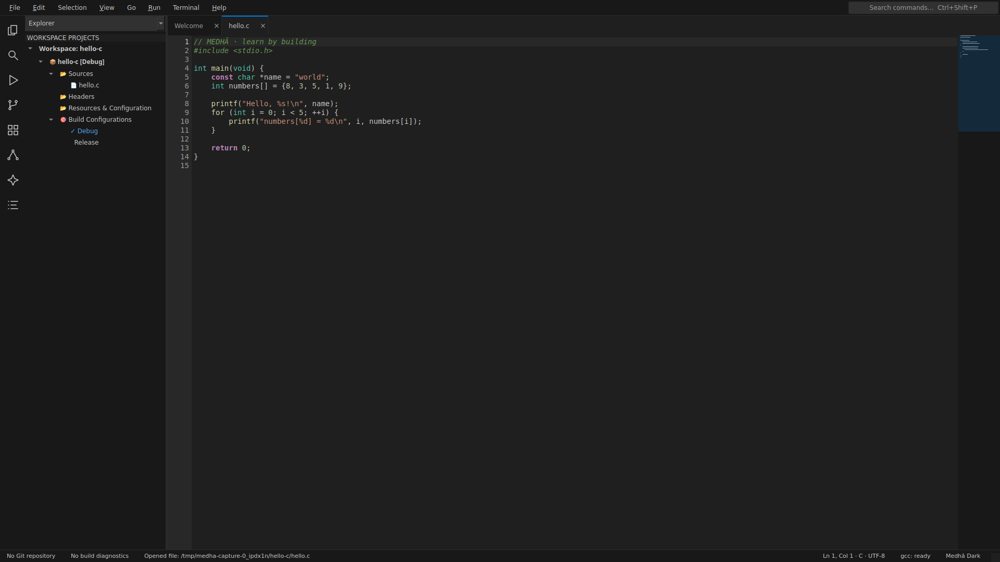

<p align="center">
  
</p>

# MEDHĀ IDE

**Offline C, C++, Java and Python IDE with a VS Code-style workbench, visual learning tools and Turbo C compatibility.**



The 2.0.0 workbench release is being prepared here; Store links install the
currently published package. See [CHANGELOG](CHANGELOG.md) for release status.

[Get MEDHĀ IDE from Microsoft Store](https://apps.microsoft.com/detail/9ndcdm1mmh5t) ·
[Install from Snap Store](https://snapcraft.io/medha-ide) ·
[View all seven new UI screenshots](store/screenshots-v2/README.md)

## New workbench

- Activity bar, collapsible sidebar and bottom panel; Ctrl+B/Ctrl+J and remembered sizes.
- Medhā Dark and Light themes, syntax highlighting, editor minimap and grey tab-close buttons.
- Command centre and palette (Ctrl+Shift+P), Quick Open (Ctrl+P) and workspace search.
- Welcome tab with New/Open, Recent files, Turbo C examples and Learn DSA visually.
- DSA, memory, disassembly, debug, AI and extension tools remain accessible in the new layout.
- Real document, branch and compiler status; optional CPU/RAM display.
- Save/Discard/Cancel protection for unsaved documents.

---

## What MEDHA Is

MEDHĀ is a **native desktop IDE** written in Python with PySide6 (Qt 6). Editing and local toolchains work offline. Open VSX downloads need internet, and optional AI needs a reachable Ollama service. No Electron, no web views, no bundled browsers. It integrates your system toolchain (gcc, g++, gdb, python3, clangd, pylsp, cmake, git, ollama) into one editor-first workbench.

**Not a web app.** The `legacy/` folder (archived) was a React/Vite/Monaco prototype — it is not MEDHA.

---

## Real Features (Implemented in `medha/`)

| Feature | Module | Status |
|---------|--------|--------|
| Multi-tab code editor with syntax highlighting | `medha/editor.py`, `editor_widget.py` | ✅ |
| Real compilation & execution (gcc/g++/python3) | `medha/runner.py` | ✅ |
| Integrated terminal (real shell via QProcess) | `medha/terminal.py` | ✅ |
| Problems panel (parses compiler stderr) | `medha/problems.py` | ✅ |
| LSP client — clangd (C/C++), pylsp (Python) | `medha/lsp.py` | ✅ (needs clangd / python-lsp-server installed) |
| GDB debugger (C/C++) + debugpy (Python) | `medha/debugger.py`, `debugger_engine.py` | ✅ GDB verified; debugpy needs `pip install debugpy` |
| Git status, stage, commit, log, diff | `medha/git_backend.py` | ✅ |
| CMake configure & build (multi-target Debug/Release) | `medha/build.py`, `build_system.py` | ✅ |
| Live disassembly (gcc -S) | `medha/compiler/disassembly.py` | ✅ |
| Project explorer | `medha/explorer.py` | ✅ |
| Local Ollama AI chat panel | `medha/ai.py`, `ai_panel.py` | ✅ |
| Open VSX extensions: themes, snippets, grammar subset | `medha/extensions/` | ✅ |
| Memory visualizer & pointer inspector | `medha/visualizers/memory_view.py` | ✅ |
| DSA visualizer (arrays, trees, graphs) | `medha/dsa_visualizer/` | ✅ |
| Symbol outline | `medha/editor_widget.py` | ✅ |
| Static safety linter (cppcheck integration) | `medha/analyzers/linter.py` | ✅ |

---

## Install

### Windows

Install [MEDHĀ IDE from Microsoft Store](https://apps.microsoft.com/detail/9ndcdm1mmh5t).
The packaged app includes offline GCC/G++, Java and Python toolchains.

### Linux (Snap)

Use the [Snap Store listing](https://snapcraft.io/medha-ide), or:

```sh
sudo snap install medha-ide
# Optional: allow projects on removable drives
sudo snap connect medha-ide:removable-media
```

The strict Snap includes compilers but does not support GDB/ptrace or direct use
of host-installed tools. Git, CMake, cppcheck and external language servers are
not bundled in this Snap. Source builds can use installed system tools.

### From source

```bash
# 1. Clone and enter
git clone https://github.com/Kanak234/medha-ide.git
cd medha-ide

# 2. Create venv and install deps
python3 -m venv .venv
.venv/bin/pip install -r requirements.txt
# Requirements: PySide6>=6.12, psutil>=7.2, requests>=2.34

# 3. Run
.venv/bin/python -m medha
```

**System dependencies** (install via your package manager):
- `gcc` `g++` `gdb` — C/C++ compilation & debugging
- `python3` — Python execution & debugpy
- `clangd` — C/C++ LSP (optional but recommended)
- `pylsp` / `python-lsp-server` — Python LSP (optional)
- `cmake` `make` — CMake build system
- `git` — Git integration
- `ollama` — Local AI (optional)
- `cppcheck` — Static safety linting (optional)

---

## Run Tests & Validators

```bash
# Offline unit tests (real network tests require MEDHA_NETWORK_TESTS=1)
QT_QPA_PLATFORM=offscreen .venv/bin/python -m pytest -q
.venv/bin/python -m pyflakes medha
QT_QPA_PLATFORM=offscreen .venv/bin/python -m pytest tests/test_ui_smoke.py -q

# Adversarial validator (Phases 1-2): window, runner, terminal, diagnostics
.venv/bin/python verify_medha.py

# Adversarial validator (Phases 3-6): LSP, debugger, git, build, hygiene
.venv/bin/python verify_medha_p3_p6.py

# DSA visualizer verification
.venv/bin/python verify_dsa_visualizer.py
```

**Validators use runtime-generated values** — hardcoded/mocked output cannot pass.

---

## Limitations (Honest)

- **No VS Code JavaScript extensions** — only Open VSX extensions that are pure data (themes, snippets, TextMate grammars). Node.js-based extensions (language servers, debuggers, formatters) cannot run.
- **LSP requires external binaries** — `clangd` for C/C++, `pylsp` for Python. Install them separately; MEDHA will auto-detect if on PATH.
- **Debugpy for Python** — install via `pip install debugpy` (or `--break-system-packages`).
- **Tool availability depends on the package** — Store/Snap builds bundle compilers; source builds use configured or system tools. The strict Snap restrictions are listed above.
- **Release preparation** — these new screenshots were captured on Linux; Windows 2.0.0 build/install/launch/uninstall acceptance remains pending.
- **Interactive terminal (B3)** — PTY/ConPTY improvements are coming in this release on `v2-bugs`; they are not yet part of this preparation branch.
- **No web browser, no Monaco, no LibreOffice, no VLC, no game engine** — those were in the archived `legacy/` prototype.

---

## Logo

The logo mark is in [`docs/assets/logo-mark.svg`](docs/assets/logo-mark.svg).

---

## License

MEDHĀ IDE is licensed under **GPL-3.0-or-later**. See [LICENSE](LICENSE) for the full license text.
Third-party components are listed in [THIRD_PARTY_NOTICES](THIRD_PARTY_NOTICES).