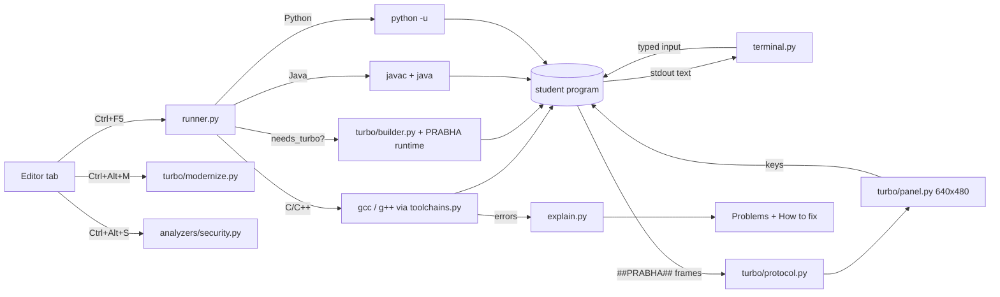

# Gate #21 — Visualize · Worst case · Victory

## 1. Visualize

## 2. Worst case → mitigation
| Risk | Mitigation |
|---|---|
| Store rejects (policy 10.2.x: app runs user code / downloads code) | Code runs only on the user's own action; extensions limited to themes/snippets/grammars; listing says so (store/STORE_POLICY_CHECK.md) |
| Antivirus / SmartScreen flags compiled student .exe | MSIX is Microsoft-signed; student programs are built in %TEMP%\medha-work; document "exclude folder" for lab admins |
| Compiler missing | bundled toolchains + Tools → Toolchains shows the real state + clear message, never a crash |
| Huge package | one-folder PyInstaller, no tests/caches; size printed by build_msix.ps1 |
| Power cut during build | builds are per-run temp folders; settings saved atomically (os.replace) |
| Crash on a lab PC | `MEDHA.exe --selftest` for lab admins; read-only install folder handled (workspace → Documents\MEDHA Projects) |
| Hindi Windows username breaks MinGW | ASCII work folder (C:\Users\Public\medha-work) |

## 3. Victory
* Measurable: Store installs ≥ C-Lite's GitHub downloads within 1 month; 1 university lab pilot; ≥ 50 GitHub stars.
* Demo script: open 05_national_flag.c → Ctrl+F5 → flag on screen (Linux AND Windows) → break a `;` → Hinglish fix → Modernize.
