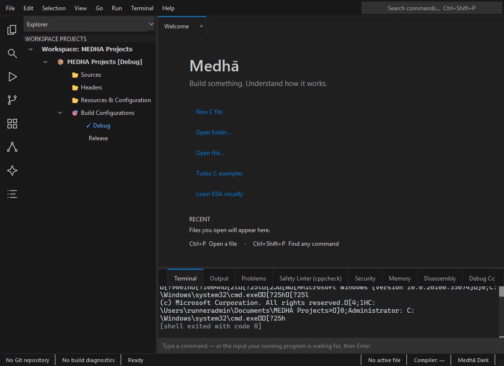
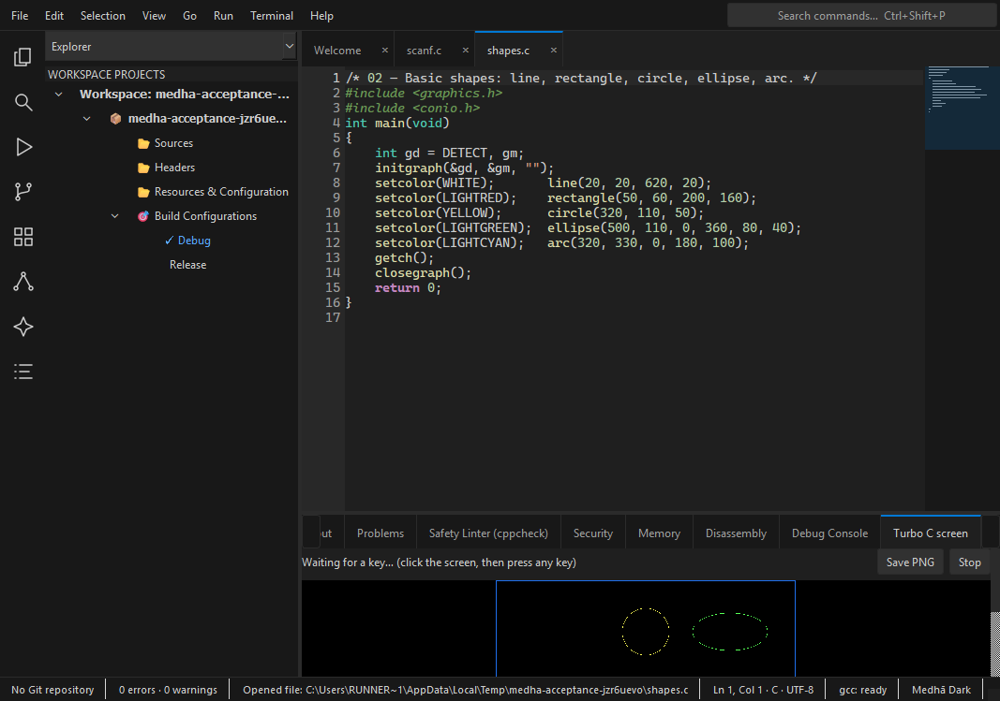

# Windows release acceptance — 2026-11-05

**Do not submit this build yet.** The build succeeds, but frozen terminal evidence
and the existing Store version block acceptance. No release/tag/Store submission
was created. The publishing `windows-msix.yml` workflow was not dispatched.

## Provenance

- Main source: `d71238e4e9086863ce35064369829a4b5a1b2421` (B11 + B12).
- Validation branch commit: `63492545728552b1c78e4dba9da0c8017cab9863`.
- [Artifact-only Windows run](https://github.com/Kanak234/medha-ide/actions/runs/41924745789)
  completed successfully on windows-latest, Python 3.13.17.
- [MSIX/portable ZIP and evidence artifact](https://github.com/Kanak234/medha-ide/actions/runs/41924745789/artifacts/13369462001):
  `medha-windows-validation`, 1,049,625,932 bytes.
  Archive SHA256: `d8ec3e2d4f1363ba6559750d77f1bd8b1b4f5338d211989f2878de8d6d63cdc6`.
  This is the Actions archive digest, not the individual MSIX digest.
- Built with `packaging/windows/build_msix.ps1`: `MEDHA-2.0.0.msix` and
  `MEDHA-2.0.0-portable.zip`. No signing files were changed.
- Small evidence entries were extracted from the downloaded archive prefix and
  inspected. The slow full local download was stopped; the full artifact remains
  on GitHub. Package payload/manifest has not been independently inspected locally.

## Results and limits

| Check | Result |
|---|---|
| Windows offline suite + pyflakes | 212 passed, 6 skipped; lint clean |
| Existing main Windows CI on Python 3.12 | 212 passed, 6 skipped, run 41922910693 |
| Source GUI startup | Passed |
| Frozen GUI startup from system working directory | Window/Welcome capture passed; terminal issue below |
| Frozen C compiler selftest | Build script step succeeded; individual stdout not independently inspected |
| Source ConPTY `dir`, continuous ping, Ctrl+C, then another `dir` | Passed, real Windows shell |
| Source C build/run with terminal `scanf` input | Passed, input 21 produced ANSWER=42 |
| Source Turbo C graphics example | Passed, decoded framebuffer; screenshot shows drawing |
| MSIX install, installed launch/interaction, uninstall | Not performed |
| Installed C scanf / Turbo graphics / terminal Ctrl+C | Not performed |
| Manual breakpoint debugging, DSA stepping, save/close/reopen project | Not performed in this Windows acceptance run |
| Extension install/uninstall | Not performed; offline suite does not establish this |
| Linux regression | 216 passed, 2 skipped; lint clean; 20 UI smoke tests passed |

Source acceptance uses the real app and bundled GCC, but is not equivalent to an
installed MSIX test. No interactive Windows desktop was connected to this chat.
See [source results](screenshots/windows-acceptance/source-results.json) and
[frozen GUI JSON](screenshots/windows-acceptance/frozen-gui.json).

## B13: frozen terminal evidence requires investigation

The screenshot is captured by `medha/smoke_gui.py` **before** `window.close()`.
It shows visible terminal control sequences and `[shell exited with code 0]`.
The smoke test only asserts window visibility and Welcome; its PASS does not
assert terminal health. Source ConPTY acceptance passed, so do not describe B11
as wholly broken or this frozen behavior as resolved without further evidence.
Root cause of the frozen shell exit has not been established.

The source Turbo check captures an actual decoded graphics frame. Runner display
dimensions constrain this evidence image; it is not a replacement Store screenshot.

## Store version gate

Partner Center was inspected read-only. The live submission's Packages page
shows **MEDHA-2.0.1.msix, v2.0.1.0, X64**. The requested 2.0.0 build is lower than
that existing package version. Version selection must be resolved before upload;
no silent version bump or new submission was made. User decision is pending.

Release requires resolving B13, verifying the installed package, addressing the
remaining manual checklist and choosing a Store-compatible version. Keep existing
Store copy/screenshots unchanged until those gates are satisfied.
